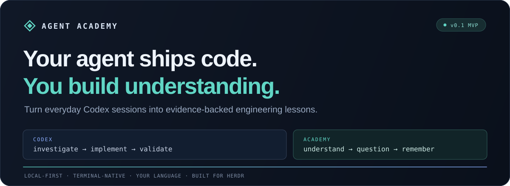

<div align="center">
  

  <p><strong>The senior engineer beside your coding agent.</strong></p>
  <p>Problems. Root causes. Framework internals. Real code. Actual test results.<br />Learn the engineering behind the changes, inside your terminal.</p>

  <p>
    <a href="https://nodejs.org/en/download"></a>
    <a href="https://herdr.dev"></a>
    <a href="LICENSE"></a>
    <a href="docs/verification.md"></a>
  </p>

  <p><a href="#quick-start">Install</a> · <a href="docs/installation.tr.md">Kurulum ve işletim rehberi</a> · <a href="#try-it-without-an-api-key">Try the demo</a> · <a href="docs/usage.tr.md">Türkçe kullanım rehberi</a></p>
</div>

---

## The agent fixed it. Can you explain why it broke?

AI coding agents can investigate a bug, change the implementation, run tests, and finish the task before you have built a mental model of the problem.

**Agent Academy turns that work into something you can understand, question, and remember.**

It opens beside Codex in Herdr, observes the existing session, and connects the investigation to engineering concepts: the error that mattered, the mechanism behind it, the code that changed, the alternatives, and the tests that support the result.

> **Codex implements the solution. Academy helps you understand the engineering.**

Start Codex the way you already do. Academy reads local session records independently; it does not send instructions to the coding agent or edit your application.

## One guided explanation

Academy has one continuous reading surface. As Codex works, it explains what we are looking at, what the evidence suggests, which code changed and why, and what the checks show. Relevant code and small evidence-backed diagrams appear inside the explanation.

Language detection runs locally on your own Codex messages. Code, logs and assistant replies do not determine the teaching language. A clear new language switches future explanations; short neutral commands such as `push` retain the earlier conversation language. No language picker or extra model request is needed. Offline narration includes English and Turkish; other languages use your configured explanation model. Existing fixed-Turkish settings migrate automatically without changing provider consent.

New explanations continue below the previous ones. Scroll up to reread; Academy keeps your place until you return to the latest message with **End**. Press **Enter** to ask a follow-up question and read the answer in the same conversation. A Markdown debrief is saved locally when the task finishes.

### Go deeper than “we moved the method”

Suppose Codex investigates a Spring `@Transactional` self-invocation bug. A useful explanation should connect the actual `this.persist()` call to proxy interception, transaction boundaries, repository behavior, propagation, alternative designs, and a focused rollback test.

That is the teaching engine's brief. With an explanation model configured, deep mode asks for the mechanisms, real code, alternatives, edge cases, and verification strategy. It has no fixed paragraph limit; context, output budget, and analysis frequency are configurable.

Structured lessons retain evidence references and eleven detailed sections for the saved debrief. The conversation presents the explanation naturally and marks possible causes as uncertain. An agent's root-cause claim remains an attributed observation; a passing command is evidence of that command's result.

## Quick start

Use **Herdr's managed installation** for everyday use. It builds and validates a separate installation before registering the plugin. The primary target is Ubuntu 24.04; Linux and macOS are supported. The interface is in English. Explanations follow the language you use with Codex automatically.

| Prerequisite | Minimum / requirement                            | Check                              |
| ------------ | ------------------------------------------------ | ---------------------------------- |
| Node.js      | 22.19, including built-in SQLite                 | `node --version`                   |
| npm          | 9, with access to your approved package registry | `npm --version`                    |
| Git          | Available on PATH                                | `git --version`                    |
| Herdr        | 0.9.3; compatible running server                 | `herdr --version` / `herdr status` |
| Codex        | Normal CLI session for live observation          | `codex --version`                  |

**1. Install.** Run from a terminal with the prerequisites on PATH; review Herdr's source and build preview:

```bash
herdr plugin install ozaimoglu/agent-academy
```

The installer checks the environment, installs locked dependencies, builds into a staging directory, and runs the offline observation → lesson → SQLite → report pipeline against synthetic data. It records the source revision, Node executable and artifact checksums. An API key is not required. No source-sharing decision is made during installation.

**On Ubuntu 24.04:** see the [native Ubuntu setup and Docker acceptance guide](docs/ubuntu.tr.md). The Ubuntu image can run the offline demo immediately after `docker build -t agent-academy:ubuntu .` and `docker run --rm agent-academy:ubuntu`. For live Herdr/Codex integration, use the native installation above.

**2. Verify.** Check registration and run the same offline acceptance checks:

```bash
herdr plugin list --plugin local.agent-academy --json
herdr plugin action invoke local.agent-academy.verify
herdr plugin log list --plugin local.agent-academy --limit 5
```

The plugin must be enabled and the `verify` action must finish with **`succeeded`, exit code 0**. `plugin_action_invoked` / `running` only acknowledges an asynchronous action. For diagnostics, invoke `local.agent-academy.doctor` and inspect its log.

**3. Open.** From the Codex pane inside Herdr:

```bash
herdr plugin action invoke local.agent-academy.open
```

Academy opens in a **right-side split**, approximately **38%** wide by default. Installation registers a Herdr plugin; it does not change your Codex configuration or require a different launch command.

**Opening the panel does not start learning.** Focus the Academy pane and press **B · Start** for the task you want to learn from. Press **D · Stop** to stop capture and cancel an in-flight explanation. On task completion, Academy prepares the final debrief and returns to standby; the next task needs another **B**. Press **Q** inside the panel to close it, or use:

```bash
herdr plugin action invoke local.agent-academy.close
herdr plugin action invoke local.agent-academy.toggle
```

Standby performs local session discovery only: no event ingestion, source/diff collection or automatic model requests. Restarting learning skips completed work from the stopped period. An ongoing task's latest message may be retained as context; preceding investigation events are not backfilled. Existing lessons remain readable, and explicit follow-up questions can still use the configured model without enabling capture.

<details>
<summary><strong>Version pinning, updates and removal</strong></summary>

For repeatable deployments, replace the placeholder with a reviewed full commit SHA:

```bash
academy_revision="<approved-full-commit-sha>"
herdr plugin install ozaimoglu/agent-academy --ref "$academy_revision"
```

Update a branch-tracking installation with `herdr plugin update local.agent-academy`. A SHA-pinned installation stays pinned; reinstall with the next approved SHA to upgrade, or a previous approved SHA to roll back. Close Academy panels before maintenance, verify afterward, then reopen. Codex and the Herdr server can keep running.

Remove with `herdr plugin uninstall local.agent-academy`; settings and learning history are preserved. [Deployment, rollback, backups and troubleshooting →](docs/installation.tr.md)

</details>

<details>
<summary><strong>Source checkout / developer installation</strong></summary>

```bash
git clone https://github.com/ozaimoglu/agent-academy.git
cd agent-academy
./scripts/install.sh --dry-run --link
./scripts/install.sh --link
./scripts/install.sh --check
```

`--dry-run` previews without changing dependencies, output or registration. `--link` explicitly registers this checkout after validation; omit it to build for standalone use. `--check` checks the installation receipt and runs offline acceptance without installing dependencies. The launcher uses the recorded absolute Node path even if the Herdr server has a different PATH.

Source links do not receive managed updates. If this plugin is already linked locally, follow the [explicit migration procedure](docs/installation.tr.md#mevcut-yerel-bağlantıyı-yönetilen-kuruluma-taşıma) before using managed installation. The installer never migrates or unlinks it automatically.

</details>

### Your first minute

The onboarding runs **inside the product**:

| Step               | Choose                                                                                | Default                                            |
| ------------------ | ------------------------------------------------------------------------------------- | -------------------------------------------------- |
| **1 · Depth**      | Quick summary, balanced, or deep explanations                                         | Deep                                               |
| **2 · Style**      | Visuals, real code, fundamentals, senior engineering, interaction                     | Visuals + code + fundamentals + senior engineering |
| **3 · Priorities** | Debugging, fundamentals, design decisions, performance, tests, security, code reading | All project topics                                 |
| **4 · Model**      | Offline, existing Codex quota, local, or remote explanation provider                  | Offline                                            |

Use arrow keys, Space, and Enter. Advanced provider settings are expandable. Press **S** later to revisit your preferences.

Preferences describe how you learn, across projects and technology stacks. Relevant languages and frameworks are inferred from observed project evidence. Older Spring/TypeScript preferences migrate to fundamentals/code reading; provider credentials and consent are preserved. Saving onboarding leaves the panel in standby.

If Herdr provides a reliable native session identity, Academy uses it. Otherwise it matches the exact project directory. When several sessions match, press **C** to choose one.

## Try it without an API key

Run a complete local demo from a checkout:

```bash
git clone https://github.com/ozaimoglu/agent-academy.git
cd agent-academy
./scripts/install.sh
npm run demo
```

The demo runs the **same JSONL adapter, evidence collector, lesson pipeline, SQLite store, and report exporter** used by live mode, against an isolated deterministic Spring transaction fixture. It never calls a remote model. Its recorded Java test results are synthetic fixture data; Academy does not execute those Java tests.

Complete onboarding, then press **B** to replay the demo. Live mode starts at the current position; only the explicitly selected demo and headless replay process historical fixture records.

Already built? Export a demo report without an interactive terminal:

```bash
node --disable-warning=ExperimentalWarning dist/cli.js --demo --headless > demo-report.md
```

Observe a real project without Herdr:

```bash
npm start -- --project /absolute/path/to/project
```

## Bring your explanation model

| Provider                               | Behavior                                                                                                                                                                                                             |
| -------------------------------------- | -------------------------------------------------------------------------------------------------------------------------------------------------------------------------------------------------------------------- |
| **Offline**                            | Local observation, structured evidence, code views, timeline diagrams, and reports. No generated framework tutorial or model Q&A.                                                                                    |
| **Ollama / local compatible endpoint** | Detailed lessons and Q&A through a loopback OpenAI-compatible HTTP endpoint. Use an actually local model; a server can still forward requests to a cloud model.                                                      |
| **Remote compatible endpoint**         | Detailed lessons and Q&A over HTTPS, after explicit consent for the project, endpoint, and model.                                                                                                                    |
| **Existing Codex CLI / ChatGPT quota** | Reuses the CLI's saved ChatGPT login for independent, ephemeral teaching requests. No API key. Requires project-specific consent; explanations consume the same account allowance. Codex CLI 0.163.x on Linux/macOS. |

No API key is assumed. Credentials are referenced by **environment variable name**, rather than saved in the settings. Available token usage is recorded; estimates are labeled. Automatic explanations are coalesced around engineering milestones, with a default minimum interval of 60 seconds.

Already use Codex with ChatGPT? Open **S → 4**, select **Codex kotası / ChatGPT girişi** with Space, then Enter. Review the project-sharing notice and press **O** to approve. The model can stay blank to use Codex's built-in default, or be set under advanced settings. Your implementation session is never resumed, forked, or sent teaching prompts. Academy starts a separate ephemeral request in an empty temporary directory with restricted read permissions, command execution, MCP, plugins, browsing, and agent delegation disabled. It does not extract or copy login tokens. Remaining allowance is checked in Codex with `/status`; the token counter in Academy records teaching usage, not remaining quota.

**Offline mode gets you started. A configured explanation model enables the deeper teaching experience.** [Provider setup →](docs/usage.tr.md#açıklama-modeli-yapılandırma)

### Ask the questions a summary never answers

- “Bunu daha temelden anlat.”
- “Bu sınıftaki gerçek kod üzerinden açıkla.”
- “Alternatif çözüm ne olurdu?”
- “Bu kod production’da hangi problemleri doğurabilir?”
- “Bu davranışı testle nasıl kanıtlarız?”

Choose a lesson and concept, ask your question, and keep the answer attached to that lesson. The implementation session continues independently.

## Built around evidence

```text
Existing Codex JSONL + observable messages + commands + diffs + source
                                  │
                                  ▼
                 Normalize → Deduplicate → Collect evidence
                                  │
                                  ▼
         Investigating → Hypothesis → Root-cause observation
                                  │
                                  ▼
                  Implementing → Validating → Completed
                                  │
                                  ▼
                 Lessons · Code · Diagrams · Q&A · Debrief
```

- **Incremental observation.** Partial JSONL writes, UTF-8 byte offsets, duplicate records, file replacement, and restart checkpoints are handled explicitly.
- **Session isolation.** Canonical project paths and scoped persistence keep workspaces separate. Ambiguous session matches require selection.
- **Relevant context.** Bounded evidence selection and source excerpts keep model requests focused. Entire raw transcripts are not sent with every question.
- **Traceable claims.** Generated references must exist in the selected evidence set. Citation validation checks reference integrity; it cannot independently prove technical correctness.
- **Honest uncertainty.** Missing tests, unknown causes, unsupported formats, and failed providers are exposed.

## Local first, by design

Lessons, reports, Q&A, usage, and checkpoints live in local SQLite and Academy state directories. Source reads resolve real paths inside the selected project, with common sensitive files excluded. Obvious secrets and terminal control sequences are redacted before captured context is persisted or sent to a model; automated redaction cannot catch every secret.

Remote source sharing requires explicit project-specific opt-in. HTTP explanation providers receive no executable tools. Academy does not commit, push, modify application code, or send prompts to the implementation agent.

[Storage locations, privacy boundaries, and retention →](docs/usage.tr.md#yerel-veri-ve-gizlilik)

## Project status

**v0.1.0 MVP.** The application is implemented; validation scope is documented openly.

- **130 automated tests** cover installation, onboarding, live-format parsing, partial writes, deduplication, session matching, reconnection, milestones, evidence, providers, privacy, Q&A, reports, and TUI navigation. The single conversation starts explaining immediately, includes code and cited diagrams inline, retains reading position, and accepts follow-up questions without changing screens. Installation tests exercise prerequisite failures, staged promotion, rollback, repeated installation, integrity checks, concurrent-install protection and runtime path binding through real subprocesses with isolated tool doubles.
- Build, lint, deterministic demo, and actual project-matching **Codex 0.163.0** command/result parsing were verified during development.
- Ubuntu 24.04 container validation covers clean installation, build/lint/tests, SQLite, offline reports, real loopback HTTP and real PTY keyboard navigation. The production image runs as a regular user with development dependencies removed. CI covers Ubuntu with Node 22.19 and 24.
- Herdr pane open/close actions were exercised on the installed macOS server after fixing split targeting; the launcher is tested from another project directory. Native Ubuntu desktop/Herdr integration and real-model explanation quality still need target-machine validation.
- Codex rollout JSONL is an internal compatibility surface, so future format changes may require adapter updates. Claude Code/OpenCode adapters, semantic call graphs, browser rendering, and automatic documentation retrieval are outside this MVP.

[Full verification record →](docs/verification.md)

## Develop

```bash
npm ci
npm run check
```

`check` runs ESLint, strict TypeScript checks, the test suite, and the application build.

```bash
npm run smoke:provider       # Real loopback HTTP smoke test; no model or API key needed
npm run smoke:codex          # Real Codex/ChatGPT request; consumes quota; sends only synthetic data
npm start -- --doctor       # Local diagnostics
npm run verify:install      # Verify an installation created by scripts/install.sh
npm start -- --help         # CLI options
```

## Documentation

- [Kurulum ve işletim rehberi](docs/installation.tr.md) — prerequisites, managed deployment, pinned revisions, acceptance checks, updates, rollback, backups and removal.
- [Türkçe kullanım rehberi](docs/usage.tr.md) — keyboard controls, provider settings, storage, troubleshooting, and limits.
- [Architecture decisions](docs/architecture.md) — integration research, boundaries, and implementation choices.
- [Verification record](docs/verification.md) — what was exercised and what remains unverified.
- [MIT license](LICENSE).

Built with TypeScript, React/Ink, and SQLite. Designed for engineers who want the code to work **and** want to understand why.
